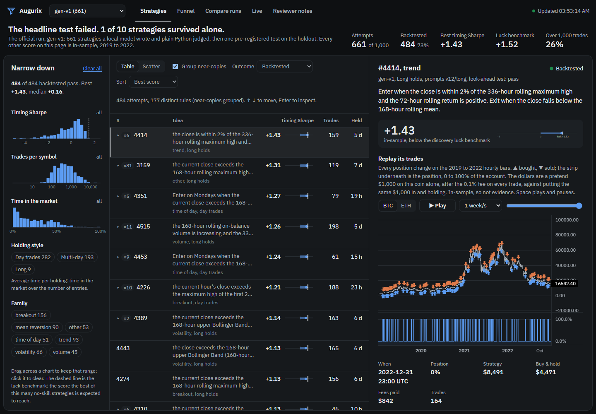
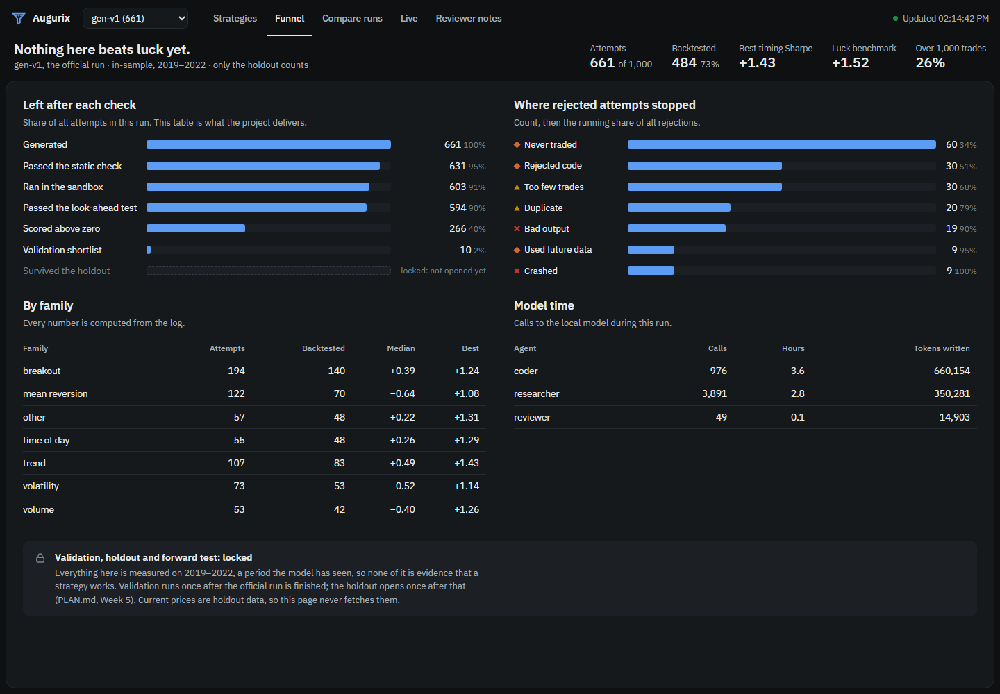
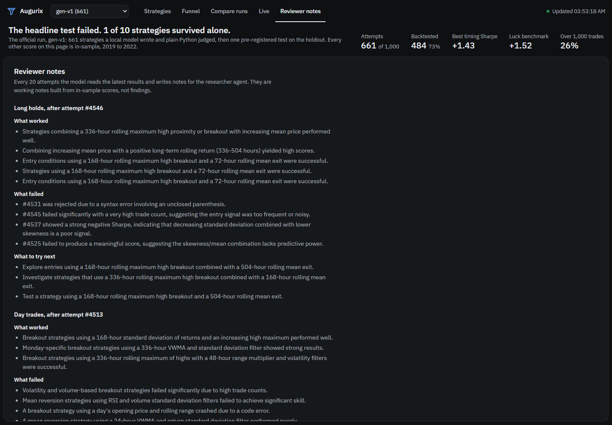

# Augurix

A local AI proposes trading strategies and writes them as code. Plain Python decides whether any of them work.

Most "AI trading" projects show a good backtest. This one is built to find out whether a good backtest means anything. A language model running on one consumer GPU generates hundreds of strategies for Bitcoin and Ethereum; each one is sandboxed, checked for cheating, scored after fees, and corrected for the number of ideas tried. The deliverable is a **survival funnel**: how many strategies were generated, and how many survived each check, ending with one test on market data the model could not have seen. Zero survivors is an acceptable result.

> **Status (2026-11-22):** done. The official run, the single validation pass and the one-shot holdout test have all happened. **The pre-registered headline test failed;** one of ten shortlisted strategies passed its own stricter test, by a hair. Details below.



## Result

The survival funnel of the official run `gen-v1`, as pre-registered in [`PREREGISTRATION.md`](PREREGISTRATION.md) (tag `prereg-v1`, pushed before any holdout data was downloaded):

| Stage | Left |
|---|---|
| Generated | 661 |
| Passed the static check | 631 |
| Ran in the sandbox | 603 |
| Passed the look-ahead test | 594 |
| Timing Sharpe above 0 on discovery (2019–2022) | 266 |
| Individually significant on validation (2023–2024) | 13 |
| Shortlisted (top 10) | 10 |
| **Survived the holdout (Mar 2025 – Oct 2026)** | **1** |

- **Headline test, failed.** The equal-weight portfolio of the ten had a holdout timing Sharpe of +0.47, with a probabilistic Sharpe ratio of 0.73 against the 0.95 required. At double the fee it was −0.18.
- **Per-strategy test, one survivor.** #4323, a day-trade volatility breakout: buy when an hour's move exceeds three times the past week's typical move and the price is above the week's high, and sell 12 hours later. It scored a holdout timing Sharpe of +1.85, with a probabilistic Sharpe ratio of 0.9964 against a Bonferroni bar of 0.995. It is in the market about 4% of the time, and a few large moves carry the result.
- **No deflated Sharpe on the validation shortlist passed:** the best was 0.28, against a luck bar of 2.17 for 534 trials.

Read plainly: a 12B model running on one GPU produced one strategy that just cleared a pre-registered test on data it could not have seen, inside a portfolio test that failed. That is weak evidence. It is not a reason to trade. Seven of the ten shortlisted strategies were one "Monday breakout" idea, and all seven lost or went flat on the holdout. That pattern was noticed after the fact and is not itself a finding.

## How it works

```
researcher ─► coder ─► static check ─► Docker sandbox ─► judge ─► log ─► reviewer
    ▲                                  (strategy + look-ahead test)          │
    └──────────────── summary of what was tried, discovery data only ◄──────┘
```

1. **Researcher agent** proposes one idea in plain English ("buy when the 168-hour average crosses above the 504-hour average; sell when it falls back"). Code turns away re-tunings of earlier ideas and near-copies, and alternates exploring new kinds of strategy with refining good ones. Day trades and longer holds can be searched as separate islands so one lucky result cannot pull the whole search toward it.
2. **Coder agent** writes the idea as a Python function that returns a position (0 to 100% long) for every hourly bar.
3. **Static check** rejects imports, file access and hard-coded calendar years before anything runs.
4. **Docker sandbox** runs the code with no network, no files and capped memory and CPU. Data goes in on stdin and positions come out on stdout.
5. **Look-ahead test** reruns the strategy on truncated copies of the data. If a position changes when later bars are removed, the code used the future and is rejected.
6. **Judge** (`backtest.py`, plain NumPy) scores the positions after a 0.1% fee per trade. No model ever scores anything.
7. **Reviewer agent** reads each batch of results and writes notes the researcher works from. Failures go back to the coder with the error, up to three tries.

All three agents are one local model (Gemma 4 12B, 4-bit, served by llama.cpp) with different prompts. Nothing calls a paid API.

## Why the results can be trusted

| Risk | What blocks it |
|---|---|
| The model remembers what the market did | Three time splits: discovery 2019–2022, validation 2023–2024, holdout from March 2025. The model's training ends January 2025, so only the holdout is truly unseen. |
| Code that peeks at future prices | The truncation test above, plus a static check for hard-coded dates. Tested against planted cheats. |
| The holdout leaks into development | Holdout months are not even downloaded until the test is pre-registered and tagged in git. The downloader refuses without the tag. |
| Trying thousands of ideas until one looks good by luck | Every attempt is logged and counted. The score that matters is the **timing Sharpe** (what a strategy earns beyond holding the same average position), judged with the probabilistic and deflated Sharpe ratio (Bailey and López de Prado). Shuffled-in-time copies of each strategy act as a null control. |
| Moving the goalposts after seeing results | `PREREGISTRATION.md` fixes the shortlist, the test and the thresholds, and is committed and tagged before the holdout data exists. `open_holdout.py` runs once, refuses if any judge file changed since the tag, and records that it ran before computing anything. |
| Generated code harming the machine | It runs only in the locked-down container. |

## What the pilots found

In-sample, on discovery data only:

- **Fees decide most results.** Strategies that trade more than 1,000 times over four years have a median timing Sharpe near −2.7. Day-trade strategies (held under a day) lose to the 0.2% round-trip cost almost every time.
- **The model converges.** Left alone, Gemma refines its single best result dozens of times ("hill-climbing on noise"). One run put 81 ideas on top of one lucky strategy; another produced ten top results that were one rule with a different filter each. Code-level checks for re-tunings, near-copies and over-refined lines, an exploration fallback, and per-style islands were added in response.
- **Nothing beats luck yet.** The best pilot scores sit at the level the best of that many no-skill strategies is expected to reach (about +1.3 to +1.5 annualised).
- **The look-ahead test catches real cheats.** About 3% of generated strategies used future data and were rejected.

## The dashboard

`python dashboard.py`, then http://127.0.0.1:8000. A read-only workbench over the log: filters on the left, strategies in the middle, the selected strategy on the right. Every score is drawn against zero and the luck benchmark on the same small ruler, so "is this better than luck?" is answered wherever a score appears.

- **Strategies:** linked filters (drag across histograms of score, trades and time in the market, or box-select a scatter), near-copies collapsed into one row per rule, and a replay of any strategy's trades on the historical candles with each buy and sell marked as it happens.
- **Funnel:** how many attempts survived each check, where the rest stopped, and results by family.
- **Compare runs:** up to three runs side by side.
- **Live:** a running search as it happens: progress toward the official run's 1,000 attempts, each style's scores arriving in order against the luck line, and the researcher's latest proposals with the ones code turned away.
- **Reviewer notes:** the reviewer agent's working notes.

It shows discovery data only and never fetches live prices, because current prices are holdout data.





`?run=NAME` in the address opens a given run, for example http://127.0.0.1:8000/?run=gen-v1#funnel.

## Rerunning it

There are two levels. Checking the published result needs no GPU. Running the experiment again needs the GPU, and it is a new experiment: the model is sampled, so a new run proposes different strategies.

### Check the published result

Requirements: Python 3.12 or later, and Docker Desktop for 12 of the tests.

```
git clone https://github.com/ALatif11/Augurix && cd Augurix
python -m venv .venv
.venv\Scripts\pip install -r requirements.txt
docker build -t augurix-sandbox .
.venv\Scripts\python -m pytest -q
```

The tests use synthetic data only. They include the backtester's toy example and properties, the 14 planted look-ahead cheats, the deflated Sharpe ratio's reference cases and simulation, and the Week 5 locks.

The official run is in `results/`:

| File | What it holds |
|---|---|
| `gen-v1_attempts.parquet` | All 661 attempts of the official run: idea, code, status, scores on discovery, prompt version |
| `gen-v1_validation.parquet` | The 266 strategies scored on validation, with the shortlist flag and each code's SHA-256 |
| `validation_gen-v1.json` | The validation summary (N, luck bar, pass rates, shortlist) |
| `holdout_gen-v1.json` | The holdout result |
| `HOLDOUT_OPENED.json` | The lock: when the holdout was opened |
| `data_manifest.json` | Every data file's checksum and download time |

`tests/test_results.py` checks these files against each other: the funnel counts, N = 534, the holdout outcome, and that each shortlisted strategy's code hashes to the SHA-256 registered in `PREREGISTRATION.md`.

`git log -1 prereg-v1` shows when the pre-registration was committed. `results/data_manifest.json` (a copy of `data/manifest.json`) records each data file's SHA-256 and when it was downloaded; the holdout months come after the tag.

### Run the experiment again

Also needed: Windows with WSL (Ubuntu), an NVIDIA GPU with about 10 GB free, and llama.cpp built with CUDA in WSL (`cmake -B build -DGGML_CUDA=ON && cmake --build build --config Release -j`) at `~/llama.cpp`. Put a Q4_K_M GGUF of Gemma 4 12B instruct at `~/models/gemma-4-12B-it-Q4_K_M.gguf` (7.7 GB, from Hugging Face). A different model works through the `LLM_MODEL` and `LLAMA_ARGS` variables in `overnight.cmd`.

The five commands, with Docker Desktop running:

```
.venv\Scripts\python download_data.py           (Binance bulk data, 2019-2024, checksums verified)
.venv\Scripts\python make_splits.py             (discovery, validation; the holdout is not downloaded)
overnight.cmd pilot1 2 both                     (a pilot: starts the model server, searches for 2 hours, stops it)
overnight.cmd myrun 12 both --n 1000 --official (the official run; rerun the same command to resume)
.venv\Scripts\python dashboard.py               (http://127.0.0.1:8000)
```

Each run writes `runs/NAME.log` and `runs/NAME_report.md`. Pilots never count toward N and can never reach validation.

Validation and the holdout run once per experiment, in a fixed order, and the scripts enforce it. This repository's locks are already spent, so a replication needs its own: work in a fresh clone, delete `results/` and the local `prereg-v1` tag there (`git tag -d prereg-v1`), and never push that clone over this one. Then:

1. `run_validation.py --run myrun`, once, after generation is final. It writes `PREREGISTRATION.md`.
2. Commit `PREREGISTRATION.md`, tag it `prereg-v1`, and push, so the tag has an outside timestamp.
3. `download_data.py --holdout --end YYYY-MM` (the last complete month). It refuses without the tag.
4. `open_holdout.py --run myrun`, once. Whatever it prints is the result.

### The bake-off

`bakeoff.py` compares how well models drive the pipeline, on discovery-only pilot runs with the same server settings. The result is in [WRITEUP.md](WRITEUP.md#bake-off).

```
set LLAMA_ARGS=-c 8192 -fa on -ctk q8_0 -ctv q8_0
set LLM_MODEL=Qwen3-14B-Q4_K_M
overnight.cmd bake-qwen 3 both --n 100
set LLM_MODEL=gemma-4-12B-it-Q4_K_M
overnight.cmd bake-gemma 3 both --n 100
.venv\Scripts\python bakeoff.py bake-qwen bake-gemma
```

## Files

| File | What it does |
|---|---|
| `backtest.py` | The judge: positions to net returns and metrics |
| `lookahead.py` | Look-ahead detector (truncation test) |
| `dsr.py` | Probabilistic and deflated Sharpe ratio |
| `agents.py` | Model client and the researcher, coder and reviewer prompts and checks |
| `generate.py` | The agent loop (LangGraph), unattended runs, run reports |
| `pipeline.py`, `sandbox.py`, `harness.py`, `static_check.py` | One attempt: check, sandbox, score, log |
| `store.py` | DuckDB attempt log |
| `baselines.py` | Hand-written reference strategies |
| `download_data.py`, `make_splits.py` | Data and the time splits |
| `run_validation.py`, `open_holdout.py` | Validation, pre-registration and the one-shot holdout test |
| `bakeoff.py` | The bake-off table |
| `WRITEUP.md` | The write-up: method, result, limitations |
| `dashboard.py`, `dashboard.html` | The dashboard |
| `PLAN.md` | Every decision and the reasoning behind it, the schedule and the specs |

## Limits

- Long or flat only, on two symbols, with hourly bars and a flat 0.1% fee. No shorting, leverage, slippage model or funding costs.
- Strategies can see absolute dates and price levels. That could help a rule keyed to something the model remembers, but only on data from before its cutoff, so it cannot help on the holdout.
- One 12B model at 4-bit. A stronger model might propose better ideas; whether it would find real edge is exactly what this setup is built to test.
- The holdout is about 21 months. A Sharpe ratio measured over that long has a standard error of roughly 0.75, so only a large effect can pass.
